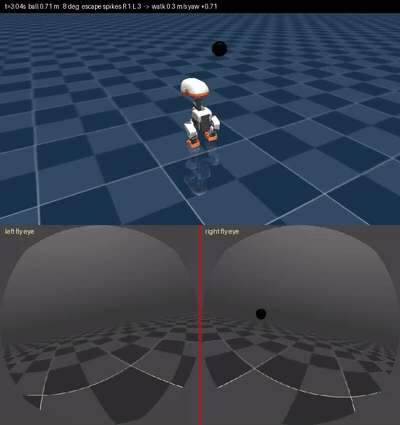
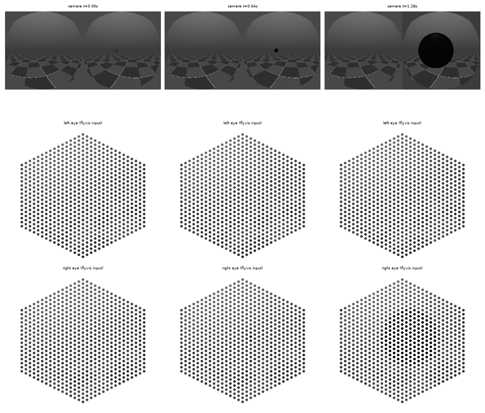
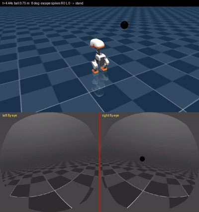
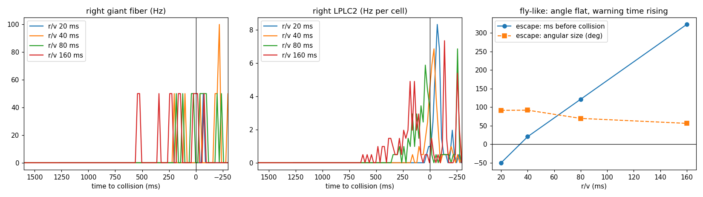
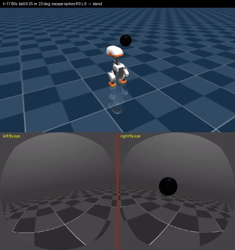
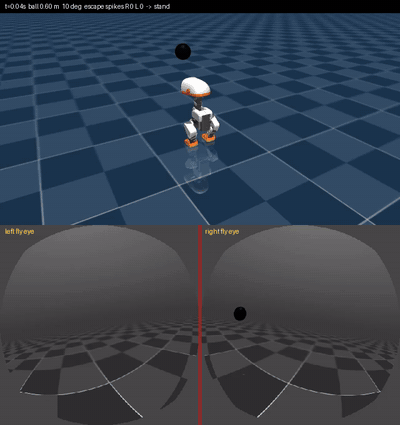
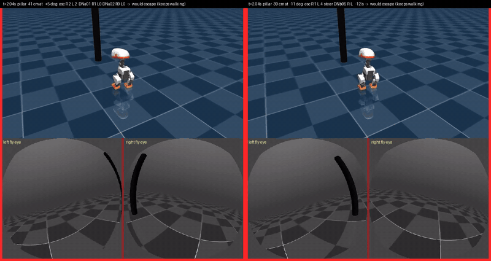
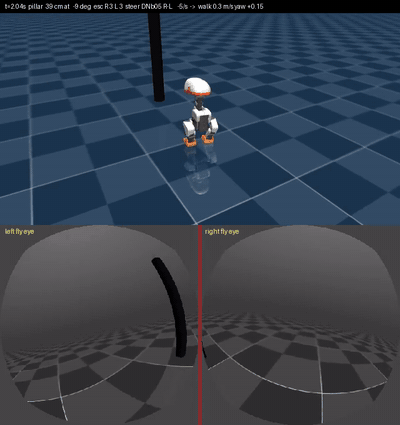

# micro-fly: a real fly brain drives a walking robot duck

A simulated two-legged robot (Pollen Robotics' **Microduck**, in MuJoCo) sees the world through
**simulated fly eyes**, and the **wiring diagram of a real fruit fly brain** (FlyWire, ~139,000
neurons) decides what it does. Nothing in the brain is trained: every decision comes from the
connectome's own wiring.



*The duck walks forward; a ball is thrown at it from the right. The fly brain's looming detectors
fire, the escape pathway triggers on the right side, and the duck backs off to the left. Top: the
simulation. Bottom: what the two fly eyes see.*

**So far:**
- **Milestone 1 - looming escape.** A ball flies at the standing duck; the fly's escape circuit
  triggers on the correct side and the duck steps out of the way (6/6 dodged, 0 false alarms).
- **Milestone 2 - walking, steering and escaping with one brain.** The duck walks; a descending
  neuron of the fly brain (DNb05) steers it around pillars, and the escape circuit still dodges
  thrown balls, without being set off by the duck's own walking.

## How it works

```
 MuJoCo Microduck ──► two 150° head cameras ──► flyvis (connectome-constrained fly eye, 45,669 cells)
        ▲                                                   │  voltages -> firing rates
        │                                                   ▼
 Pollen walking policy ◄── (vx, vy, yaw) ◄── FlyWire LIF brain (Shiu et al.), 32,811 eye-driven
 (stands in for the          command        "puppet" neurons -> optic lobe -> central brain:
  fly's nerve cord)                           escape:   DNp01 / DNp02 / DNp11, confirmed by LPLC2
                                              steering: DNb05 left vs right
```

1. **Eyes.** Each 150° camera image is resampled to equal-angle pixels, rotated to match the fly
   eye's lattice, and fed to the pretrained [flyvis](https://github.com/TuragaLab/flyvis) network.
2. **Bridge** (`build_bridge.py`). 32,811 FlyWire optic-lobe neurons are matched to the flyvis cell
   of the same type in the same eye column. Each becomes a *puppet*: its brain inputs are cut and
   it fires at the rate its flyvis twin dictates.
3. **Brain** ([Shiu et al. leaky integrate-and-fire model](https://github.com/philshiu/Drosophila_brain_model),
   FlyWire v783, Brian2, compiled with Cython). Runs in 20 ms steps alongside the simulation.
4. **Readout.** Spikes of a few brain neuron types, left vs right, become walking commands
   (details in the stages below). Pollen's walking policy turns those commands into leg movements.

Everything runs headless: physics, offscreen rendering of the eyes, the brain, and the videos
(`loop_*.mp4`) that the GIFs here are cut from.

---

## The stages

### Stage 1 - Fly eyes on a duck
The duck gets two 150° cameras on its head (10° overlap in front), roughly matching a fly's field
of view. Their images are resampled so that each pixel covers the same angle, then fed to flyvis.
Early versions used one narrow camera split in half, which magnified everything about 4×; another
bug used the first frame as the "nothing happening" baseline, so a receding ball looked like a
permanent change. Both were fixed (baseline = empty scene).



### Stage 2 - Wiring the eye into the brain
`build_bridge.py` maps flyvis cells to FlyWire neurons by cell type and eye column (column
assignment from Matsliah et al. 2024). The two hexagonal lattices are aligned using the anatomy of
the motion detectors (T4/T5 preferred directions); a moving-grating test then confirmed the
directions. A sign error in the alignment (flyvis edge offsets are target − source) once rotated
the whole eye by 180° and was caught by that test.

### Stage 3 - Making the brain behave like a fly's
With real eye input, the giant fiber (DNp01, the escape command neuron) fired most for *sideways*
motion, not for looming. `explain_neuron.py` traced it to a mutual-excitation loop between DNp70 and
the giant fiber, kicked off by central neurons. Silencing DNp70 (and Li33) restored looming
selectivity. A Brian2 detail also mattered: assigning synapse weights with a boolean mask was
silently ignored, so the "silencing" and the puppets' input cut had never been applied; integer
indices fixed it.

### Stage 4 - Closing the loop: the brain escapes, but the body doesn't get out of the way
Eyes, brain and duck now run together (`fly_loop.py`; three Python environments over pipes).
Escape spikes (DNp01 + DNp02 + DNp11) per side in the last 100 ms trigger an escape command. The
escape triggered on the correct side, before contact, and never for a passing ball or an empty
scene, but backing up and turning did not move the duck out of the ball's path.



### Stage 5 - Timing
`loom_sweep.py` measured when each neuron type responds as a function of approach speed (r/v).
LC4 responds early (~10-15°), LPLC2 later (~25-30°), as in flies. Two changes made the escape early
enough: doubling the eye-to-brain gain (LPLC2 receives ~390 excitatory but ~310 inhibitory synapses
from the eye, `inputs_of.py`) and deciding every 20 ms instead of every 100 ms.



### Stage 6 - Milestone 1: the dodge
`fly_loop.py --motion-sweep` showed that Pollen's walking policy barely moves when told to walk
straight back or sideways; it only walks properly when turning. The escape became *back + sidestep
+ turn away*, and the duck started dodging.




*Left: ball at r/v 500 ms from 60° right; escape at 44°, 1.3 s before impact; misses by 7 cm.
Right: a ball passing by at 60 cm triggers nothing.*

Statistics (`dodge_trials.py`: 3 independent trials per side, r/v 160 ms ≈ 0.3 m/s, from 60°):

| | Result |
|---|---|
| Looming balls dodged | **6 / 6** (3 from the right, 3 from the left) |
| Escape on the threatened side | **6 / 6** |
| False alarms (ball passing by on each side, empty scene) | **0 / 3** |
| Ball's angular size when the escape triggered | 27 - 45° |
| Warning before impact | 0.40 - 0.66 s |
| Closest gap between ball and duck | +1.2 to +4.3 cm (mean +2.3 cm) |

<details><summary>Per-trial table</summary>

| run | outcome | gap cm | escape side | deg | warning ms | moved cm |
|---|---|---|---|---|---|---|
| right 1 | missed | +2.3 | right | 43 | +423 | 22 |
| right 2 | missed | +2.4 | right | 41 | +443 | 22 |
| right 3 | missed | +4.3 | right | 27 | +663 | 25 |
| left 1 | missed | +2.1 | left | 39 | +463 | 24 |
| left 2 | missed | +1.4 | left | 42 | +423 | 23 |
| left 3 | missed | +1.2 | left | 45 | +403 | 23 |
| pass right | no escape | - | - | - | - | 0 |
| pass left | no escape | - | - | - | - | 0 |
| empty scene | no escape | - | - | - | - | 0 |

</details>

### Stage 7 - Walking, and finding the neurons that see obstacles
The duck walks at its policy's top forward command (about 9 cm/s in practice). Left alone it curved
26° to the right in 7 s, so a *heading hold* (a stand-in for the fly's haltere/vestibular course
control) turns it gently back to its start heading. `steer_probe.py` then walks it straight past a
pillar on either side and compares every readout neuron type left vs right:

| Neuron type | Fires more on the pillar's side? |
|---|---|
| LC4, LPLC4, LPLC2, HS cells (visual projection neurons) | yes, strongly |
| **DNb05** (descending neuron, brain → body) | **yes**, clean, from ~13-20 cm away |
| DNa01 / DNa02 (classic turning neurons) | slightly, toward the pillar (cf. flies turning toward dark stripes) |

The wiring agrees: DNb05's largest inputs are LPLC4 (+2,053 synapses) and LLPC2 from the same-side
eye.

### Stage 8 - Steering with the fly's own descending neuron
Steering command: `yaw = heading hold + 0.04 × (DNb05 right − left, spikes/s over 300 ms − 5)`,
i.e. the side where DNb05 fires more is turned away from. Without steering the duck walked into the
pillar on both sides; with it, **6/6 runs cleared** the pillar (gaps +3.8 to +11.0 cm), each
time moving away from it.



*Left: no steering, walks into the pillar. Right: DNb05 steering, the duck turns away and passes it.*

### Stage 9 - Milestone 2: one brain that walks, steers and escapes
With walking on, the duck's own movement made the escape neurons fire constantly (DNp01 about 13
spikes/s), so every walk ended in a false escape. LPLC2, the fly's dedicated looming detector,
stays almost silent during plain walking (0-5 spikes in 7 s), so an escape now also needs **≥ 3
LPLC2 spikes on the same side within 100 ms**, and LPLC2 decides the side. The ball thrown at the
walking duck re-aims at it until it looks 15° wide and then flies straight, so the duck cannot
dodge it by accident.



Results (`walk_trials.py`, every scene with the same settings):

<!-- M2_RESULTS_START -->
| Scene | Should | Result (2 runs each) |
|---|---|---|
| Walking, nothing around | no escape | **2/2** without a false escape |
| Pillar 6 cm right of the path | get around it | **cleared 2/2** (closest gap +22.4, +29.5 cm); every escape on the pillar's side |
| Pillar 6 cm left of the path | get around it | **cleared 2/2** (+28.7, +28.2 cm); every escape on the pillar's side |
| Ball thrown at the walking duck from the right | escape away, ball misses | **missed 2/2** (+2.1, +3.4 cm); escape on the ball's side 2/2, ball 58-61° wide, 277 ms before impact |
| Ball thrown at the walking duck from the left | escape away, ball misses | **missed 2/2** (+6.0, +1.0 cm); escape on the ball's side 2/2, ball 44-49° wide, 337-417 ms before impact |
| Standing duck, ball from the right (Milestone 1 check) | escape away, ball misses | **missed 2/2** (+2.4 cm both); ball 41° wide, 443 ms before impact |

12 runs, no falls. Escape gate: LPLC2 ≥ 3 spikes in 100 ms; ball r/v 160 ms. Near a pillar the duck
usually escapes 2-3 times (backing off and turning 54-125°), so the escape, not only the steering,
keeps it clear. The ball margins are small (1-6 cm). `walk_trials.py --repeats N` reruns this table.

<details><summary>Every run</summary>

| run | outcome | gap cm | escapes (time s, side) | drift cm | turned |
|---|---|---|---|---|---|
| open #1 | no escape | - | - | +1.8 | -6° |
| pillar R #1 | CLEAR | +22.4 | 3, first 3.72 right | +8.3 | +71° |
| pillar L #1 | CLEAR | +28.7 | 2, first 3.22 left | +1.2 | -54° |
| ball R #1 | MISSED | +2.1 | 4.78 right | -1.1 | +23° |
| ball L #1 | MISSED | +6.0 | 4.64 left | -4.6 | -26° |
| stand ball #1 | MISSED | +2.4 | 6.38 right | +2.0 | +60° |
| open #2 | no escape | - | - | +4.1 | -5° |
| pillar R #2 | CLEAR | +29.5 | 3, first 3.06 right | +19.6 | +125° |
| pillar L #2 | CLEAR | +28.2 | 2, first 3.50 left | -6.3 | -87° |
| ball R #2 | MISSED | +3.4 | 4.78 right | -0.7 | +26° |
| ball L #2 | MISSED | +1.0 | 4.72 left | -4.8 | -35° |
| stand ball #2 | MISSED | +2.4 | 6.38 right | +2.0 | +60° |

</details>
<!-- M2_RESULTS_END -->

### Stage 10 - Speed
A run is about 30× slower than real time. Profiling showed most of the brain's time went into
Brian2's set-up on every 20 ms `run()` call, not into the simulation. The brain worker now starts
one long run and exchanges data with the loop from inside it, and Brian2 compiles the model with
Cython. A run went from ~4 to ~1.5-2 minutes, with identical spike results.

---

## Setup (WSL2 Ubuntu or Linux; tested on an RTX A2000 laptop)

The scripts expect this layout, so clone this repository into `~/flyduck/bridge`:
```
~/flyduck/
  bridge/                    <- this repository (git clone https://github.com/NikBandi/micro-fly ~/flyduck/bridge)
  microduck_rl/              <- github.com/pollen-robotics/microduck_rl  (uv sync)
  Drosophila_brain_model/    <- github.com/philshiu/Drosophila_brain_model (+ .venv)
  .venv-vision/              <- Python venv with flyvis
```

1. **Duck environment.** Clone `microduck_rl` and run `uv sync`. Download `alpha_walking.onnx` from the
   Hugging Face repo `pollen-robotics/microduck-policies` into `microduck_rl/policies/`. Install `ffmpeg`.
2. **Vision environment.** `python -m venv ~/flyduck/.venv-vision`, then
   `pip install -r requirements-vision.txt`, then `flyvis download-pretrained`.
3. **Brain environment.** Clone `Drosophila_brain_model`, create its venv, install its requirements,
   then `pip install -r requirements-brain.txt` (includes `cython<3` for the compiled brain).

### Data (downloaded, not redistributed here)

Put these in `bridge/data/`:

| File | Source |
|---|---|
| `Supplemental_file1_neuron_annotations.tsv` | [flyconnectome/flywire_annotations](https://github.com/flyconnectome/flywire_annotations) (`supplemental_files/`) |
| `column_assignment.csv.gz` | FlyWire Codex download, v783 (Matsliah et al. 2024) |
| `Connectivity_783.parquet` | copy from `Drosophila_brain_model/` |
| `flyvis_nodes.csv`, `fib25-fib19_v2.2.json` | `python tools/export_flyvis_inputs.py` (vision env) |

### Build and run

```bash
cd ~/flyduck/bridge
python build_bridge.py && python validate_bridge.py                 # any env with pandas+pyarrow
~/flyduck/.venv-vision/bin/python fly_eye.py --stimulus looming      # first run calibrates the eyes

cd ~/flyduck/microduck_rl
uv run python ~/flyduck/bridge/fly_loop.py --motion-test             # duck stands, escape moves it
uv run python ~/flyduck/bridge/dodge_trials.py                       # Milestone 1 statistics
uv run python ~/flyduck/bridge/walk_trials.py --repeats 3            # Milestone 2 statistics
# one walking run with everything on (writes loop_pillar_demo.mp4):
uv run python ~/flyduck/bridge/fly_loop.py --scenario pillar --side right --walk 0.3 \
    --steer DNb05 --steer-gain 0.04 --steer-bias 5 --escape-gate LPLC2:3 \
    --eye-gain 2 --step-ms 20 --threshold 2 --escape-cmd -0.3 0.2 1.5 --tag demo
```

## Files

| File | What it does |
|---|---|
| `build_bridge.py`, `validate_bridge.py` | FlyWire to flyvis neuron mapping and lattice alignment |
| `fly_eye.py` | offline: movies to flyvis to firing rates (+ calibration, direction check) |
| `brain_bridge.py`, `make_test_rates.py`, `explain_neuron.py`, `inputs_of.py` | offline brain runs and circuit analysis |
| `duck_eyes.py` | renders the duck's two fly-eye cameras |
| `fly_loop.py`, `eye_worker.py`, `brain_worker.py`, `ipc.py` | the closed loop (three Python environments talking over pipes) |
| `loom_sweep.py`, `dodge_trials.py` | Milestone 1 experiments: loom-speed sweep and dodge statistics |
| `steer_probe.py`, `walk_trials.py`, `escape_report.py` | Milestone 2: steering neuron search, walk/steer/escape statistics, escape diagnostics |
| `tools/make_media.py`, `tools/fill_readme.py` | GIFs for this README, results table from `walk_trials` |
| `docs/development_log.md` | the full lab notebook: every result, bug and decision |

## Limitations

- Pollen's walking policy stands in for the ventral nerve cord, and the escape and steering
  commands are fixed, hand-chosen mappings from neuron spikes to (vx, vy, yaw).
- The heading hold is not from the fly brain; it stands in for the fly's own course control.
- Close to a pillar, the escape (not only the steering) does much of the avoiding.
- The eye-to-brain rate conversion (gain, calibration) is a modelling choice, not measured biology.
- Dodge margins are small (1-6 cm) and tested at one ball speed (r/v 160 ms). Faster balls
  (r/v 40-80 ms) are detected but the duck cannot get out of the way in time.
- The corridor scene (striped walls) is built but the duck does not yet keep itself centred.
- About 490 of flyvis's 721 columns per eye map onto FlyWire neurons. Seven flyvis cell types have
  no FlyWire match.

## Credits

This project builds on:
- **FlyWire connectome:** Dorkenwald et al. 2024, Schlegel et al. 2024 (Nature); column assignment
  Matsliah et al. 2024 (Nature).
- **flyvis:** Lappalainen et al. 2024 (Nature), TuragaLab.
- **Whole-brain LIF model:** Shiu et al. 2024 (Nature), philshiu/Drosophila_brain_model.
- **Microduck robot, simulation and walking policies:** Pollen Robotics (microduck_rl).

Please cite the original works if you use this. Code in this repository: MIT (see `LICENSE`).
